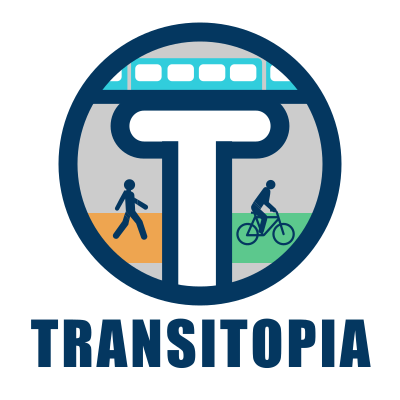
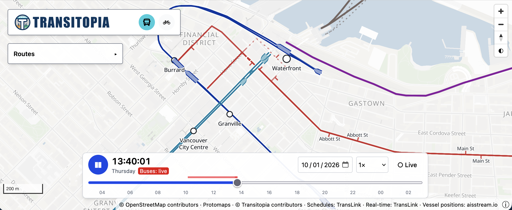

# Transitopia



Transitopia is a mapping project that aims to provide high-quality **public transit**, **cycling**, and **pedestrian** infrastructure maps. The goal is to promote best practices and celebrate high quality infrastructure, while calling attention to unsafe and low-quality infrastructure.

**Current status** (Oct 2026): We are now showing a **real-time transit map of Metro Vancouver, the Fraser Valley, Kelowna, and Victoria**. Also available is the **cycling / micromobility map** for all of British Columbia.

Online at: **[www.transitopia.org](https://www.transitopia.org/)**.



## This repository

This repository is a monorepo (npm workspaces) containing most of the parts you need to run and develop Transitopia locally:

* `apps/web`: the Single Page Application that implements the website with the Transitopia map, seen at https://www.transitopia.org
* `apps/server`: the real-time service: it polls available data feeds (GTFS Realtime, AIS, etc.), streams the data to the web app, adheres to rate limits, records history, and re-dispatches trains live.
* `packages/transit-core`: the DOM-free transit engine: GTFS, the SkyTrain track graph, run inference, a signalling-aware train dispatcher, playback, corrections, and bus prediction.
* `packages/transit-map`: the transit map engine (clock, playback, WebGL vehicle layers), mounted by the website on `/transit`.
* `packages/db`: the server's PostgreSQL migrations and types.
* `packages/map-style`: the site's basemap style (Protomaps, light and dark).
* `packages/shared`: definitions shared by the website and server, such as the dataset registry behind the map's credits.
* `pipelines`: build-time data pipelines and validators.
* `config/networks/skytrain`: the SkyTrain rail network (track infrastructure, operations, dispatch, scenarios and disruptions), and `config/feeds/translink`: TransLink's feed (routes drawn, real-time budget, SeaBus berths, observations).
* `packages/cycling-core`: the cycling/micromobility map's logic: classifying OpenStreetMap's cycling infrastructure and the cycling tiles' schema (built by `npm run data:cycling`).

How it all fits together is in [docs/DESIGN.md](docs/DESIGN.md), with each part's design in its own folder. [CLAUDE.md](CLAUDE.md) lists every command. Planned work is in [GitHub issues](https://github.com/transitopia/transitopia/issues).

## How to run Transitopia locally

There are a couple of ways to run Transitopia locally. In any case, you'll need Node.js 26+.

### The easy way: use the Transitopia.org API and data servers

If you just want to get Transitopia running locally and try changing the UI, you don't need to run the database, set up the transit data server, or build the maps locally; you can get all those from the Transitopia production site.

Just:
1. Clone this repo.
2. Run `npm install` from this repo's root.
3. Download the basemap's fonts and icons (a few MB): `npm run tiles -- --assets-only`
4. Run the `web` app:

   ```
   VITE_BASEMAP_TILES=https://map-tiles.transitopia.org/protomaps-bc.json \
   VITE_TRANSIT_OVERVIEW_TILES_CDN=https://map-tiles.transitopia.org/ \
   VITE_TRANSIT_DATA=https://data.transitopia.org/ \
   VITE_TRANSIT_API=https://api.transitopia.org/ \
   npm run dev
   ```

5. View the site at http://localhost:5173/

### The hard way: build and run everything yourself

If you want to try changing any of the datasets used (IDs, map, transit data, etc.), you'll need to do the full setup locally.

1. Clone this repo.
2. Run `npm install` from this repo's root.
3. Start the database server: `npm run db:up` (needs Docker).
4. Install [tippecanoe](https://github.com/felt/tippecanoe) 2.17 or later (`brew install tippecanoe`), which builds the transit and cycling map tiles.
5. Build the data:

   ```sh
   npm run data basemap transit cycling
   ```

   - `basemap`: a British Columbia extract of the [Protomaps](https://protomaps.com/) daily build (about a 2 GB download), plus its fonts and icons. Skipped once it exists.
   - `transit`: fetches the latest GTFS feeds and the roads buses use, then builds the timetables, the track network, the route tiles, and the dispatched train runs.
   - `cycling`: downloads the cycling data we extract from OpenStreetMap each day (about 20 MB) and builds its tiles. See [packages/cycling-core](./packages/cycling-core/README.md).

   Name only the ones you need; later, `npm run data` (transit and cycling) brings them up to date. The individual steps are in [pipelines/README.md](pipelines/README.md).
6. Run the server with `RT_FORWARD_TO=https://api.transitopia.org npm run server`
   - This will run everything locally except polling the real-time vehicle position APIs from transit agencies, which will still happen on Transitopia's API server (`api.transitopia.org`).
   - If you want your local server to fetch the live vehicle positions directly, then:
      1. Optional: create a file called `.secrets` and set any API keys you have there: `AISSTREAM_API_KEY=...`, `TRANSLINK_API_KEY=...`, etc. (BC Transit does not need an API key.)
      2. Run the server with `RT_POLL=1 npm run server`
7. In another tab/terminal, start the web frontend with `npm run dev`.
8. Go to http://localhost:5173/ in your browser.

Downloads and build output go to `var/` (gitignored). The track network itself is committed (`config/networks/skytrain/infrastructure/`), and `npm run data:osm` re-imports it from OpenStreetMap (then `npm run data transit` rebuilds on it).

## Credits

Transitopia is a project by [Braden MacDonald](https://www.bradenmacdonald.com) ([@bradenmacdonald](https://github.com/bradenmacdonald) on GitHub).


The primary source of map data is [OpenStreetMap](https://www.openstreetmap.org/). The basemap is built from the [Protomaps](https://protomaps.com/) daily build of OpenStreetMap, styled with [Protomaps basemaps](https://github.com/protomaps/basemaps) in light and dark flavours. Custom vector tiles are built with [tippecanoe](https://github.com/felt/tippecanoe).

The map is rendered using [MapLibre GL](https://maplibre.org/).

Map vector tile data is stored in the [PMTiles](https://github.com/protomaps/PMTiles) format.

Transit data sources: press the (i) button on the bottom right of the website at [www.transitopia.org](https://www.transitopia.org) to read a list of the data sources used for the map shown, or refer to [`DATA-LICENSES.md`](./DATA-LICENSES.md) for a complete list.
